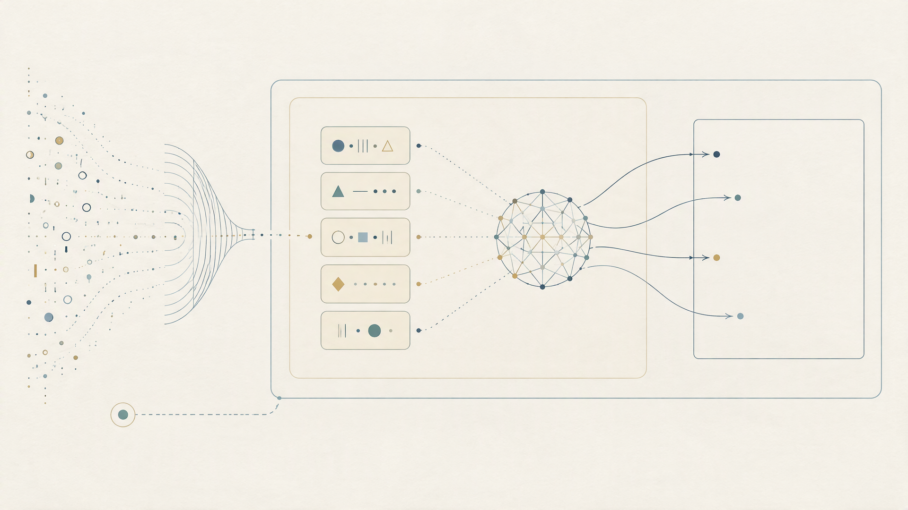
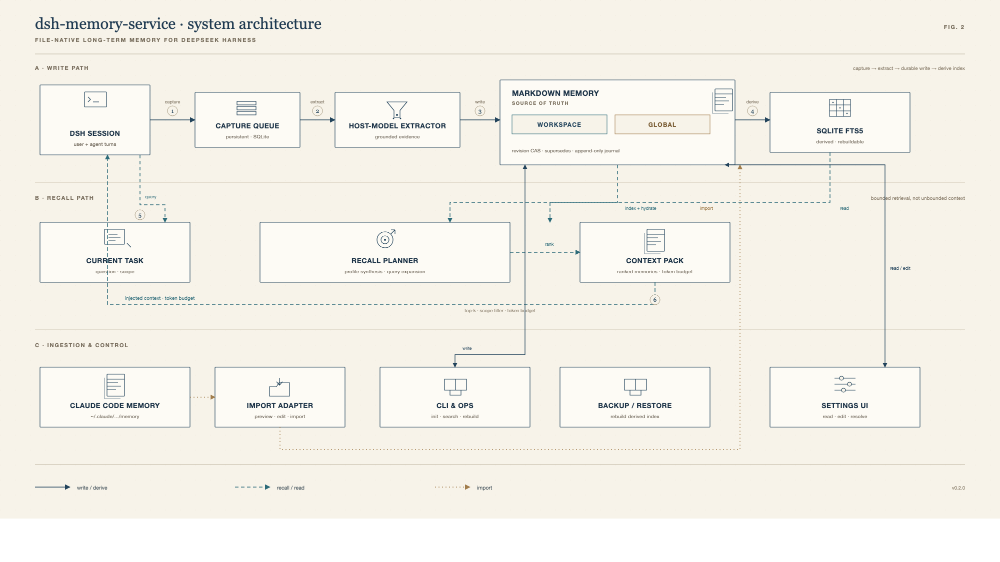

<b>Figure 1 · System overview / 图 1 · 系统总览.</b> <b>Legend / 图例：</b> 点状流 → 会话事件；同心漏斗 → 有证据的抽取与过滤；卡片 → 持久化的 Markdown 记忆；节点网络 → FTS5 检索与相关性；曲线箭头 → 受 token 预算约束的上下文注入；嵌套框 → workspace / global 双作用域；左下角圆点 → Claude Code 导入端口。

# dsh-memory-service

**为 DeepSeek Harness 提供文件原生、可审计、可重建的长期记忆。**

> 一次会话里做出的决定，不应该等到下一次会话再重新发现。
>
> dsh-memory-service 给 DSH 增加一层持久记忆：Markdown 文件是唯一真源，SQLite FTS5 只是可丢弃的检索索引，模型每轮只拿到和当前任务相关的那部分记忆。

---

## 为什么需要它

编码会话会产生大量必须跨会话保留的事实：

- 工程约定：*“这个仓库统一用 pnpm”*；
- 架构决策：*“公共 API 必须放在 adapter 后面”*；
- 工作反馈：*“不要重写生成文件”*；
- 用户偏好：*“用中文回答，状态汇报短一点”*；
- 不值得每次重新推导的项目知识。

上下文窗口是临时的。**dsh-memory-service** 把这些事实变成持久、可检查、可召回的记忆，而不是把整段聊天历史无限塞回模型。

## 核心特性

| | |
|---|---|
| **Markdown 真源** | 每条记忆是带 frontmatter 的普通 <code>.md</code> 文件，可读、可编辑、可 review、可迁移。 |
| **可重建索引** | SQLite FTS5 只负责检索加速；索引损坏或删除后可从 Markdown 重建。 |
| **双作用域** | <code>workspace:&lt;id&gt;</code> 保留项目内知识；<code>global</code> 保存跨项目约定和用户偏好。 |
| **动态回忆** | 每轮注入稳定的 preference/user profile，以及和当前问题相关的 FTS 召回，受 token 预算约束。 |
| **自动捕获** | 完成轮次进入持久捕获队列；模型判断是否值得长期保存，并保留可核验的原话证据。 |
| **乐观并发** | <code>revision</code> + <code>expectedRevision</code> 防止多会话互相覆盖；旧事实通过 <code>supersedes</code> 保留审计链。 |
| **语义冲突** | 同一 fact key 出现不同值时标记为 <code>conflicted</code>，由用户选择保留版本。 |
| **可遗忘** | 软遗忘从召回中排除；hard forget 同时删除文件与索引。 |
| **Claude Code 迁移** | UI/CLI 从多个 Claude Code workspace 或 global memory 导入；支持预览、逐条编辑、选择导入。 |
| **原生 Settings UI** | 在 DSH 设置页内查看、搜索、创建、编辑、处理冲突和展开工具卡片，不另开 web 应用。 |

## 架构

<b>Figure 2 · System architecture / 图 2 · 系统架构.</b> <b>Legend / 图例：</b>实线 = 捕获、写入与索引派生；虚线 = 召回、读取与上下文注入；点线 = Claude Code 导入；WORKSPACE 与 GLOBAL 为同级 scope；Markdown 是唯一真源，FTS5 索引可重建。<a href="docs/assets/architecture-figure.svg">SVG source</a>

**一句话数据流：** 会话事件先进入持久队列，宿主模型抽取有证据的候选，写入 Markdown 真源；索引负责可搜索，召回层再按 scope、相关性和 token 预算把一部分记忆注入下一轮。

## 安装

环境要求：

- 带插件 bundles 的 DeepSeek Harness（<code>base</code> + <code>headless</code> / desktop）；
- Node.js **&gt;= 22.5**（依赖 <code>node:sqlite</code>）；
- 不需要额外的向量数据库或 API key；抽取使用宿主模型。

### 从 npm 安装

~~~bash
dsh plugin --profile <profile> add dsh-memory-service
~~~

添加后重启 DSH。记忆页面会出现在 **Settings → Memory**。

### 从本地仓库安装

~~~bash
git clone https://github.com/howtomakeaname/dsh-memory-service.git
dsh plugin --profile <profile> add /absolute/path/to/dsh-memory-service
~~~

### 配置

编辑 <code>~/.dsh/profiles/&lt;profile&gt;/cordis.patch.yml</code>：

~~~yaml
- id: memory-service
  config:
    root: /absolute/path/to/memory
    capture: true
    budgetTokens: 1200
    extractEveryTurns: 1
    minConfidence: 0.55
    queryExpansion: true
    profileSynthesis: true
~~~

| 配置项 | 默认值 | 说明 |
|---|---|---|
| <code>root</code> | <code>$DSH_MEMORY_HOME</code> 或 <code>~/.dsh/memory-service</code> | 记忆库根目录。 |
| <code>capture</code> | <code>true</code> | 是否开启自动捕获。 |
| <code>budgetTokens</code> | <code>1200</code> | 注入预算，限制在 200–8000。 |
| <code>extractEveryTurns</code> | <code>1</code> | 每 N 轮执行一次抽取，1–50。 |
| <code>minConfidence</code> | <code>0.55</code> | 抽取置信度下限，0–1。 |
| <code>queryExpansion</code> | <code>true</code> | 用宿主模型把问题改写成额外检索 query。 |
| <code>profileSynthesis</code> | <code>true</code> | 把 preference/user 类型记忆合成短 profile。 |

非法数值会被 clamp 到合法范围，并记录 warning。

## 快速开始

### CLI

~~~bash
node src/cli.mjs init
node src/cli.mjs upsert \
  --scope workspace:demo \
  --title "Package manager" \
  --body "Use pnpm in this workspace" \
  --type convention
node src/cli.mjs search pnpm --scope workspace:demo
node src/cli.mjs list --scope workspace:demo
~~~

### Agent 工具

插件向宿主注册 9 个工具：

| 工具 | 用途 |
|---|---|
| <code>memory_search</code> | 搜索 workspace + global 中相关的过去知识。 |
| <code>memory_save</code> | 保存长期有效的偏好、约定、决策或事实。 |
| <code>memory_get</code> | 读取一条记忆的正文和 revision。 |
| <code>memory_update</code> | 带乐观并发的更新；过期 revision 会被拒绝。 |
| <code>memory_forget</code> | 软遗忘或硬删除一条记忆。 |
| <code>memory_flush</code> | 确定性地处理待捕获任务。 |
| <code>memory_conflicts</code> | 列出未解决的语义冲突。 |
| <code>memory_resolve</code> | 为冲突选择保留的版本。 |
| <code>memory_stats</code> | 查看计数和存储位置。 |

## 存储布局

~~~text
<root>/
├── global/
│   ├── MEMORY.md              # 人类可读索引
│   └── notes/*.md             # 每条记忆一个文件，带 frontmatter
├── workspaces/<workspace-id>/
│   ├── MEMORY.md
│   └── notes/*.md
├── .index/memory.db           # 可丢弃的 SQLite FTS5 索引
└── journal/events.ndjson      # 追加式审计 / journal
~~~

workspace identity 由宿主会话的 cwd 派生，而不是由模型填写。这样项目记忆天然不会串到别的工作区。

## 设置页

原生 Settings 页面覆盖完整生命周期：

- 按 workspace/global scope 浏览和筛选；
- 新建、编辑、复制、遗忘；
- 查看冲突详情并选择保留版本；
- 展开 <code>memory_*</code> 工具调用，查看参数和结果；
- 导入 Claude Code 记忆。

## Claude Code 记忆迁移

导入流程刻意做成 **review-first**，不是无脑复制：

1. 发现 <code>~/.claude/projects/*/memory</code> 和 <code>~/.claude/memory</code>；
2. 多选 Claude Code 工作区和/或 global memory；
3. 预览每条记忆的标题、描述、类型、正文和是否已存在；
4. 逐条修改标题/描述/正文/类型，并选择 workspace/global scope；
5. 只导入勾选项。

CLI 也暴露同一套适配器：

~~~bash
node src/cli.mjs discover-claude
node src/cli.mjs import-claude --source ~/.claude/projects/<project>/memory --scope workspace:demo
node src/cli.mjs export-claude --target /tmp/claude-memory-export --scope workspace:demo
~~~

导入按来源 hash 幂等；用户本地改过的条目默认不会被覆盖，除非显式使用 <code>--force</code>。

## 可靠性与验证

- **50 tests / 50 pass**（<code>node --test</code>），覆盖 schema migration、CAS、双进程并发写、队列恢复、profile synthesis 和 Claude preview/import。
- **真实 DSH e2e**：一个会话保存 → 新会话召回 → 纠正 → 再召回。
- **持久捕获队列**：中断的捕获任务会在重启后恢复并继续 drain。
- **LongMemEval 风格长程 benchmark**：24 条任务，**22/24** 通过；每条 46–49 万字符。偏好类任务是已知弱项（2/4）。
- **GitHub Actions**：每次 push 跑测试、静态检查和 <code>npm pack --dry-run</code>。

~~~bash
node --test
node scripts/check.mjs
node scripts/e2e-real.mjs --profile bench-memt-headless
node bench/e2e/run.mjs
~~~

详细证据见 [docs/verification.md](docs/verification.md) 和 [bench/e2e/README.md](bench/e2e/README.md)。

## 设计取舍

- **文件优先于不透明存储。** 即使这个插件明天消失，记忆仍然可用。
- **索引是可丢弃的。** 索引损坏或过期只意味着 rebuild，不是数据丢失。
- **召回要有边界和类型。** 一份小而相关的 profile，比把整个记忆库倒进上下文更有效。
- **抽取必须保守。** 用户原话里找不到证据，就不自动写入。
- **冲突是一等公民。** 两个会话说法不一致时，系统记录双方并交给用户选择，而不是静默覆盖。
- **workspace identity 由宿主掌握。** 模型不能靠猜测把项目事实提升成 global。

## 文档

| 文档 | 内容 |
|---|---|
| [INSTALL.md](INSTALL.md) | 安装与配置参考。 |
| [docs/architecture.md](docs/architecture.md) | 模块拆分、数据流和维护约束。 |
| [docs/dsh-plugin-contract.md](docs/dsh-plugin-contract.md) | 已验证的 DSH 插件契约与 e2e 记录。 |
| [docs/retrieval.md](docs/retrieval.md) | 正则只做触发、typed preference 写入和检索策略。 |
| [docs/conflict-resolution.md](docs/conflict-resolution.md) | 锁、CAS、supersede 和语义冲突。 |
| [docs/operations.md](docs/operations.md) | 备份、恢复、重建、队列诊断。 |
| [docs/ui.md](docs/ui.md) | Settings UI 和工具调用展示。 |
| [docs/claude-code-memory-current.md](docs/claude-code-memory-current.md) | Claude Code memory 格式说明。 |
| [CHANGELOG.md](CHANGELOG.md) | 版本历史。 |

## License

MIT，见 [LICENSE](LICENSE)。
