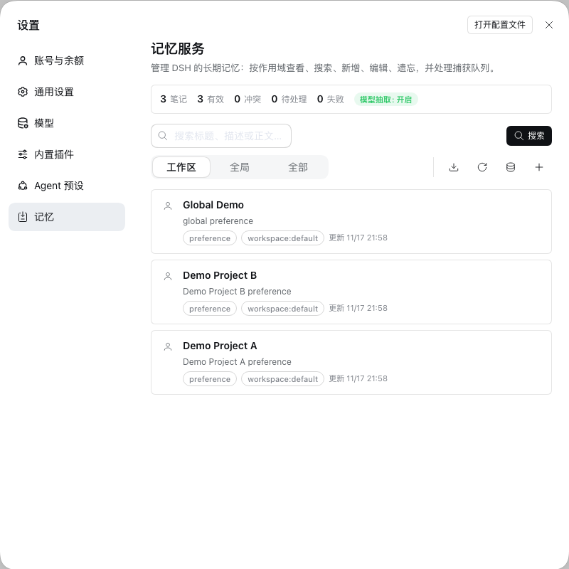

# dsh-memory-service

DSH（DeepSeek Harness）自己的长期记忆服务：Markdown 作为记忆真源，SQLite FTS5 作为可重建索引，插件层负责工具调用和按轮动态注入。

Claude Code 的 memory 格式兼容只是适配器，不是项目核心。

## 设计

- **Markdown 真源**：每条记忆是可读、可编辑、可迁移的 `.md` 文件，带 frontmatter。
- **派生索引**：SQLite FTS5 只做检索加速，删除后可重建，不是唯一数据源。
- **作用域**：`global` 和 `workspace:<id>`；工作区身份由宿主会话 cwd 派生，模型不能随意改。
- **版本与更正**：`revision`、`expectedRevision` 乐观并发，`supersedes` 标记被替代的旧事实。
- **可遗忘**：软遗忘从检索中排除；`hard` 删除同时移除文件与索引。
- **动态注入**：稳定约定 + 本轮相关记忆，按 token 预算拼接后作为 `plugin:dsh-memory-service` 消息注入。
- **工具**：`memory_search`、`memory_save`、`memory_get`、`memory_update`、`memory_forget`、`memory_flush`、`memory_conflicts`、`memory_resolve`、`memory_stats`。
- **持久捕获队列**：自动捕获先入 SQLite 队列；进程崩溃/退出后下次启动继续 drain，不依赖一次性内存任务。
- **模型抽取**：正则只做触发/节流，模型判断是否长期有效、类型、作用域；证据必须能在用户原话中找到；无 LLM 时退回确定性规则。

## 目录

```text
<root>/
├── global/
│   ├── MEMORY.md
│   └── notes/
├── workspaces/<workspace-id>/
│   ├── MEMORY.md
│   └── notes/
├── .index/memory.db
└── journal/events.ndjson
```

默认 root：`~/.dsh/memory-service`，可用 `DSH_MEMORY_HOME` 或插件配置 `root` 覆盖。

## 作为 DSH 插件

`package.json` 声明：

```json
{
  "main": "src/plugin.mjs",
  "dsh": { "bundle": { "patch": "./cordis.patch.yml" } }
}
```

插件导出：

- `inject = ['tools', 'agents', 'sessions']`
- `apply(ctx, config)`
- `ctx.on('session/event')`：捕获完成轮次里明确的长期约定（`以后…`、`记住…`、`不要再…` 等）。
- `ctx.on('agent/pre-step')`：每轮第一次进入模型前，注入稳定约定和当前问题相关记忆。
- `ctx.tools.register(...)`：注册记忆读写工具。

## CLI

```bash
node src/cli.mjs init
node src/cli.mjs upsert --scope workspace:demo --title "Package manager" --body "Use pnpm" --type convention
node src/cli.mjs search pnpm --scope workspace:demo
node src/cli.mjs list --scope workspace:demo
node src/cli.mjs forget <id> --scope workspace:demo
node src/cli.mjs rebuild
node src/cli.mjs flush
node src/cli.mjs doctor
node src/cli.mjs backup --target /tmp/memory-backup
node src/cli.mjs restore --source /tmp/memory-backup --target /tmp/memory-restore
```

## Claude Code 兼容

发现 `~/.claude/projects/*/memory` 或 `~/.claude/memory`：

```bash
node src/cli.mjs discover-claude
node src/cli.mjs import-claude --source ~/.claude/projects/<project>/memory --scope workspace:demo --project demo
node src/cli.mjs export-claude --target /tmp/claude-memory-export --scope workspace:demo
```

导入是复制到 DSH 记忆库，不修改 Claude Code 原目录；按来源 hash 幂等，用户改过的条目默认不覆盖（`--force` 可覆盖）。

## 测试

```bash
node --test
```

## 已验证

- 场景测试覆盖跨会话、插件重启、纠正、队列恢复、Claude 导入、硬删除。
- 真实 DSH 多会话 e2e：保存 → 无关会话 → 回忆 → 纠正 → 再回忆，全部通过。
- 自动捕获走持久队列；插件启动时会恢复并 drain 上次未完成的捕获任务。
- `memory_get` / `memory_update` 支持按 revision 做乐观并发。

真实 e2e：

~~~~bash
node scripts/e2e-real.mjs --profile bench-memt-headless
~~~~

在本地 `bench-memt-headless` profile 中：

1. 第一会话调用 `memory_save` 保存“本项目统一使用 pnpm”，返回 memory id。
2. 第二会话只问“这个项目应该用哪个包管理器？”，模型回答 `pnpm`。
3. 显式工具调用轮次不再被自动捕获成重复 feedback。

测试：

```bash
node --test
# 49 tests, 49 pass
```

## 宿主接口

DSH 工具注册和动态注入的实际接口、约束与验证记录见 [docs/dsh-plugin-contract.md](docs/dsh-plugin-contract.md)。

## 代码结构

模块拆分、数据流和维护约束见 [docs/architecture.md](docs/architecture.md)。

## 运维

备份、重建、队列诊断和常见问题见 [docs/operations.md](docs/operations.md)。

## Roadmap

剩余的非 UI 工作和优先级见 [docs/roadmap.md](docs/roadmap.md)。

## 并发与冲突

写锁、CAS 和语义冲突策略见 [docs/conflict-resolution.md](docs/conflict-resolution.md)。

## 验证

分层验证和真实 e2e 见 [docs/verification.md](docs/verification.md)。

## Benchmark e2e

LongMemEval/LoCoMo/GateMem 风格任务的真实 DSH 端到端 harness 见 [bench/e2e/README.md](bench/e2e/README.md)。

## UI

设置页支持搜索、scope、单条详情、冲突解决、工具卡片和 **Claude Code 记忆导入**。

DSH 设置页复用、单条记忆详情、工具调用卡片和截图见 [docs/ui.md](docs/ui.md)。



## 数据版本与备份

记忆库带 schema version 和 v1→v2 迁移；`backup` 只复制 Markdown/来源/journal，`restore` 后强制重建索引。详见 [docs/operations.md](docs/operations.md)。

## 发布验证

`npm pack` 产物已在临时项目安装并导入 `dsh-memory-service/core`，写入/检索通过；真实双进程并发 CLI 测试也通过。

## 配置

`root`、`capture`、`budgetTokens`、`extractEveryTurns`、`minConfidence` 都会规范化并做范围校验；非法值会 clamp 并写 warning。见 [INSTALL.md](INSTALL.md)。

## 纯抽取 e2e

~~~bash
node scripts/e2e-pure-extraction.mjs --profile bench-memt-headless
~~~

会话明确禁止工具调用 → flush 队列 → 检查 `capture: llm` note → 新会话召回。当前 5/5 PASS。

## CI

GitHub Actions 跑 `npm test`、`npm run check`、`npm pack --dry-run`；`prepublishOnly` 也会强制执行测试和检查。

## 检索策略

为什么正则只能做触发/兜底、偏好为什么需要类型化写入，见 [docs/retrieval.md](docs/retrieval.md)。

## 检索扩展

有 LLM 时，用户问题会先被改写成几条检索 query，再合并 FTS 召回；失败自动退回原 query。正则不做语义判断。

## Claude Code memory 参考

当前 Claude Code 2.1.284 的 memory 结构、索引限长、select/synthesize 与旧泄露快照的差异，见 [docs/claude-code-memory-current.md](docs/claude-code-memory-current.md)。

## Profile e2e

~~~bash
node scripts/e2e-profile.mjs --profile bench-memt-headless
~~~

4 条 typed preference 记忆 → synthesize profile → 新会话推荐；3/3 PASS。

## 抽取→偏好 e2e

~~~bash
node scripts/e2e-preference-extraction.mjs --profile bench-memt-headless
~~~

真实会话陈述偏好 → flush → 新会话推荐；4/4 PASS。

## Release

[v0.1.0](https://github.com/howtomakeaname/dsh-memory-service/releases/tag/v0.1.1) 提供可安装 tarball。
