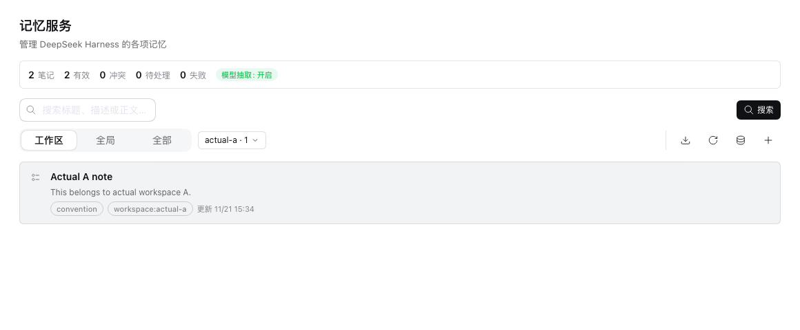
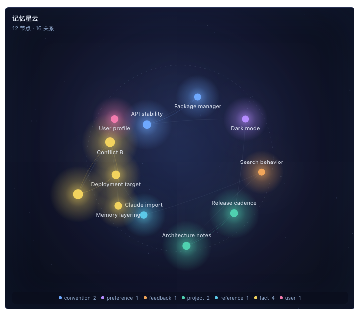
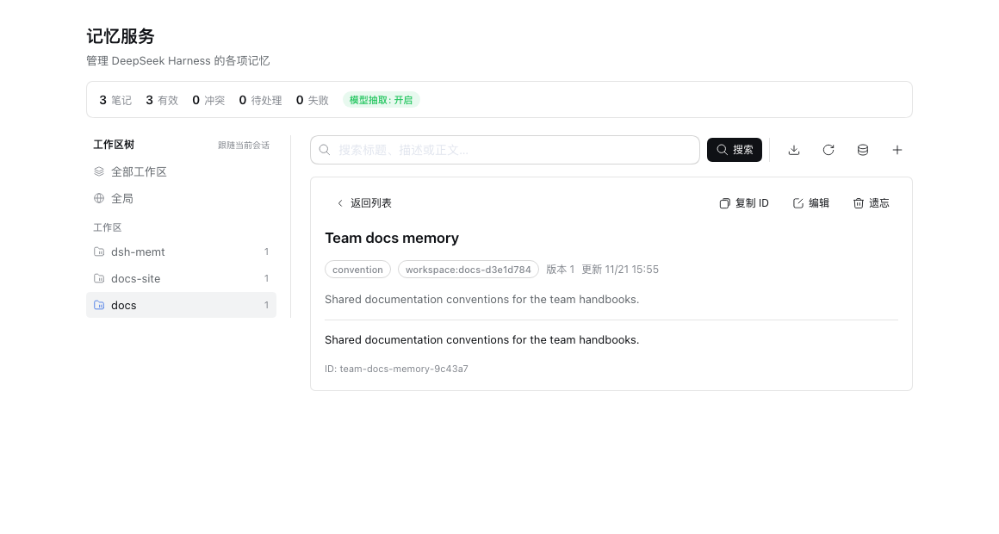
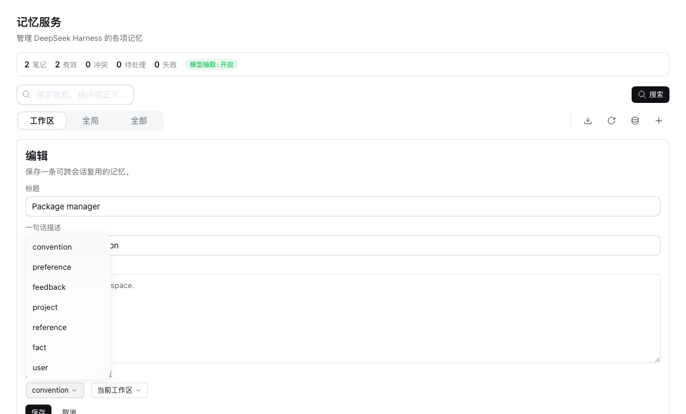
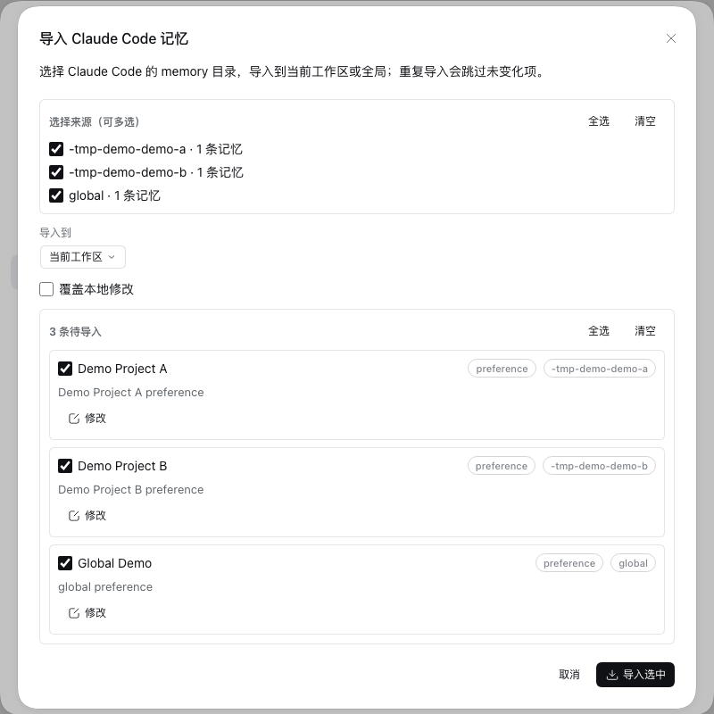

# UI：DSH 侧栏记忆面板与工具调用

## 截图

### 侧栏 → 记忆

### 星云视图

节点=记忆，连线=冲突/替代/同 key/来源/类型簇；搜索会高亮匹配节点，悬停看标题+描述，点击进入详情。

### 单条记忆详情

### 工具调用卡片

### DSH Menu 下拉

### Claude Code 导入

截图来自真实 DSH Web：

- DSH web app `0.2.2-rc.3`
- 测试 profile：`bench-memt-web`
- 真实侧栏 panel、真实弹层和真实会话，不是静态 mock；工作区树中的项目名已替换为演示用 workspace。

公开截图只保留侧栏 panel 主区内容区或对话内容区，已裁掉侧栏里的工作区、会话标题和账号信息；原始全屏截图不放在仓库里。

## 复用了什么

### 侧栏面板外壳

- slot：`sidebar.panellist`（图标 + 标签）+ root `main` keyed slot（主区页面，key = `memory-service`）
- 客户端模块：`window.__ModuleLoader__.load({ id, factory(require) })`
- locale：`ctx.locale.register` / `ctx.locale.bind`
- 图标：官方 `Icon*OutlineRegular`
- 主题：`--dsw-alias-*` CSS 变量

### primitives

当前页面实际使用：

- `Button`：搜索、刷新、处理队列、新增、编辑、遗忘、返回、复制 ID
- `Input`：搜索框、标题、描述
- `Tag`：类型、scope、模型抽取状态
- 工作区树：原生 `button` 行 + 官方 folder/workspace 图标，复刻 DSH 侧栏的信息层级
- `DisclosureRow`：工具调用折叠行
- `Menu` / `MenuItemButton`：表单里的类型、scope 下拉
- 图标：`IconSearchOutlineRegular`、`IconRefreshOutlineRegular`、`IconDatabaseOutlineRegular`、`IconPlusOutlineRegular`、`IconEditOutlineRegular`、`IconTrashOutlineRegular`、`IconChevronLeftOutlineRegular`、`IconCopyOutlineRegular`、`IconCheckOutlineRegular`、`IconInfoOutlineRegular`、`IconUserOutlineRegular`、`IconChecklistOutlineRegular`、`IconBrowseOutlineRegular`、`IconDataOutlineRegular`

原生控件只保留：

- `textarea`：多行正文；
- 列表行：需要整行点击和复合内容，用原生 `button` 承载，内部仍用 DSH token/Tag/icon。

类型/scope 已从原生 `<select>` 换成 DSH `Menu` + `MenuItemButton`；只有 primitives 不可用时才回退原生 select。

## 页面结构

### 列表

- 顶部摘要：笔记/有效/冲突/待处理/失败 + 模型抽取状态；
- 左侧工作区树：全部工作区 / 全局 / 已注册工作区 / 其他记忆工作区；从 Session 进入面板时自动选中该 Session 的 workspace；
- 工作区树默认跟随当前 Session workspace，无法判断时回退到最近写入的 workspace；点击树节点切换列表和保存 scope；
- 搜索输入即出结果（260ms 防抖），回车立即搜索，有清除按钮；
- 内容顶部搜索、冲突筛选和操作组分开：搜索/冲突在左，刷新/队列/新增图标在右；
- 列表行显示类型图标、标题、描述、type/scope、更新时间；
- 点击整行进入单条详情；
- 新建/编辑表单的作用域选择器按 DSH workspace 选择器显示标题 + 完整路径 + 勾选，workspace/global 可切换；
- 有冲突时可切换“只看冲突”，列表只显示 `conflicted` 记忆。

### 单条记忆详情

- 独立 drill-down 视图，不是把列表行展开；
- 返回列表、复制 ID、编辑、遗忘；
- 展示 type/scope/revision/updated、完整正文、ID、sourceRefs；
- 编辑复用同一表单，带 revision CAS；
- `conflicted` 详情显示冲突对象和“保留此版本”，选择 winner 后 loser 转 superseded。

### 工具调用

注册 keyed slot：

~~~js
ctx.slots.inject("tool.call.toolview", function* () {
  for (const key of Object.keys(TOOL_LABELS)) {
    yield ctx.slots.register({ name: "tool.call.toolview", key, locale: NS }, ToolRow);
  }
});
~~~

覆盖：

`memory_search`、`memory_save`、`memory_get`、`memory_update`、`memory_forget`、`memory_flush`、`memory_conflicts`、`memory_resolve`、`memory_stats`。

卡片用公开 `DisclosureRow`，标题带工具动作和参数摘要；展开后显示 Arguments / Result。running / failed 状态沿用宿主 disclosure 语义。

## 宿主 API

前端不读文件，全部走同源 JSON：

~~~text
POST /memory-service/api/state
POST /memory-service/api/list
POST /memory-service/api/search
POST /memory-service/api/get
POST /memory-service/api/workspaceIds
POST /memory-service/api/save
POST /memory-service/api/update
POST /memory-service/api/forget
POST /memory-service/api/flush
POST /memory-service/api/claudeDiscover
POST /memory-service/api/claudePreview
POST /memory-service/api/claudeImportEntries
~~~

实现：`src/api.mjs`。路由通过 `ctx.inject(['webServer'])` 懒挂载；headless profile 没有 webServer 时自动跳过。

## Claude Code 导入

- 工具栏“从 Claude Code 导入”打开官方 `Modal`；
- 通过 `claudeDiscover` 列出 `~/.claude/projects/*/memory` 和全局 memory；
- **可多选**多个 Claude 工作区和 global；
- `claudePreview` 合并所有选中来源，逐条返回标题、描述、类型、正文和已存在状态；
- 预览列表可逐条勾选、修改标题/描述/正文/类型，并为每条选择 workspace/global scope；
- `claudeImportEntries` 只导入勾选项，只接受发现列表中的 source/file，不能传任意路径；
- 导入后显示新增/更新/跳过/冲突计数，并刷新列表。

## 验证方式

1. 启动测试 profile：

~~~bash
dsh --profile bench-memt-web --port 54123 --host 127.0.0.1 --no-open
~~~

2. 浏览器打开打印出的 URL，左侧栏 → 记忆。
3. 验证列表、搜索、scope 切换、新增/编辑/遗忘、详情 drill-down。
4. 新建会话，让模型调用 `memory_save`，展开“已完成 → 已调用工具”，确认自定义卡片和展开后的 Arguments / Result。

## 已知限制

- 没有独立的 Playwright/浏览器 CI；这次是 CDP 驱动的真实 DSH 手动 e2e；
- 没有移动端/窄屏专门验证；
- 冲突解决一次处理当前记录标记的冲突对象，不做三方合并。
- textarea/select 仍是原生控件，因为 primitives 没有对应公开组件；
- 没有独立路由页，详情在侧栏 panel 主区内 drill-down。
